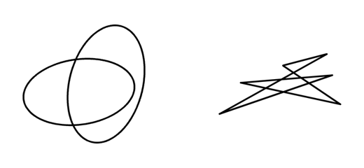
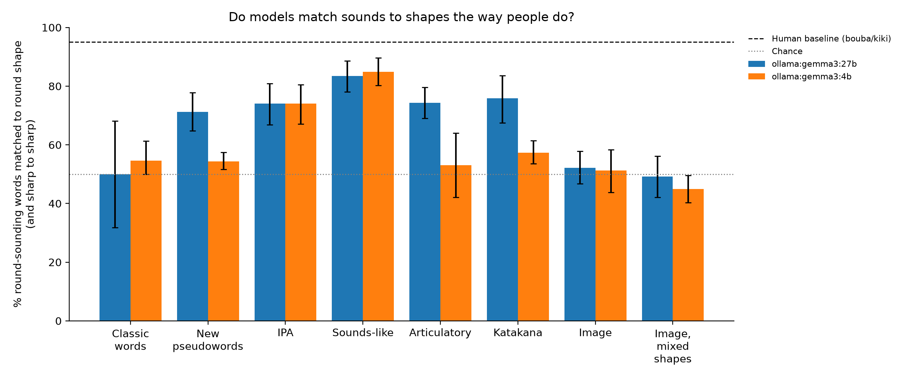
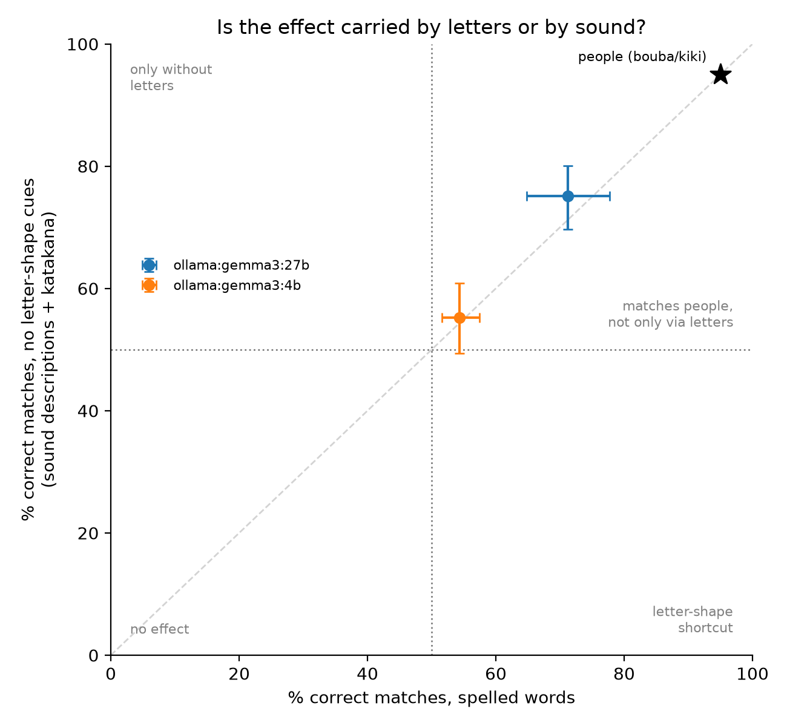
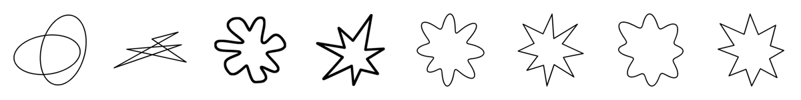
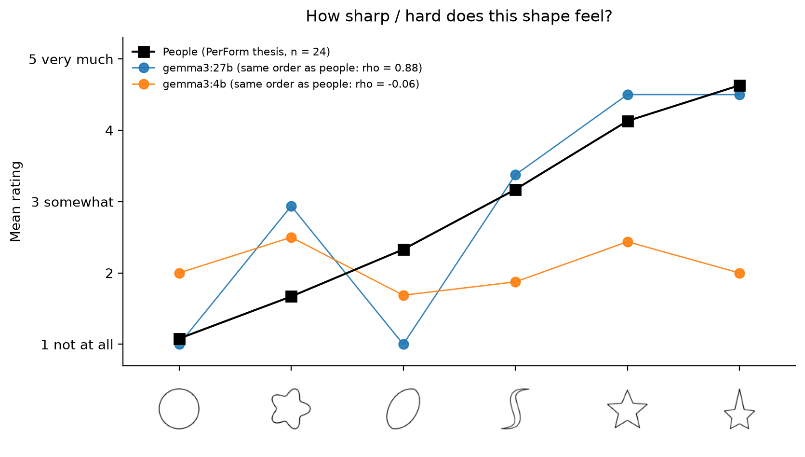

# Do AI models share human shape-sound correspondences?

<p align="center"></p>

One of these shapes is called *maluma* and the other is called *takete*. Which is which? (Redrawn after Köhler, 1929.)

Almost everyone, in every culture tested, says the round one is *maluma* and the spiky one is *takete*. The same happens with *bouba* and *kiki*. Nobody is taught this: the sounds just *feel* round or sharp. Psychologists call it the **bouba/kiki effect**, and it's one of the clearest examples of the senses being linked in the mind.

This project asks whether AI models make the same link, and if they do, **how**.

## The question

The framing grows from my MIT Media Lab thesis *[PerForm](https://hdl.handle.net/1721.1/124080)* and the idea that on people's unconscious and conscious perception, the senses connect through shared high-level concepts, not directly mapped to each other. A sharp sound and a jagged shape feel related because both reach the idea of *sharpness*.

That gives a testable prediction for AI models. If a model links sounds and shapes through a shared concept, then:

1. it should match *takete* to the spiky shape, as people do;
2. it should still do so when it can't see how the word is spelled, because the letters *o* and *b* look round and *k* and *t* look sharp, which would be a cheap shortcut;
3. it should do so when it actually **sees** the shapes, not only when they are described in words;
4. inside the model, *takete*, a picture of a spiky star and the word *knife* should all activate the same "sharpness" representation.

Phase 1 (this repo, now) tests points 1–3 by asking models questions. Phase 2 (later) tests point 4 by looking inside an open-weights model. See [docs/open-weights.md](docs/open-weights.md) for a plain-language explanation of that part.

## Early results

> **Preliminary.** Two open-weights models (Gemma 3 27B and 4B, run locally), 77 new made-up words plus 11 famous ones, 4 samples per question. Claude and Gemini haven't been run yet.

Each bar is the share of made-up words matched the way people match them (round-sounding words to the round shape, sharp-sounding to the spiky one). 50% is chance. The dashed line is the human score for bouba/kiki.



**What the conditions mean:** the same made-up word, shown in different ways.

| Condition | Example | Letter shapes visible? |
|---|---|---|
| Classic words | *bouba*, *takete*, *bamu* (famous, possibly memorized) | yes |
| New pseudowords | *mobolu*, *kitezi* | yes |
| IPA | /mo.ˈbo.lu/ | yes (almost the same letters) |
| Sounds-like | "moh-boh-loo" | yes |
| Articulatory | "a voiced nasal made with both lips, followed by a mid back vowel; …" | **no** |
| Katakana | モボル | **no** (Japanese script) |
| Image | the word, plus two pictures: classic round/spiky pairs (below) | yes, for the word; the shapes are pictures |
| Image, mixed shapes | the same, with our first set of round shapes carrying thin spikes | yes, for the word |

### What it shows so far

**1. The larger model makes the human link, but less strongly than people do.** Gemma 3 27B matched new made-up words the human way 71% of the time (95% CI 65–78%), well above chance but below the roughly 95% people reach.

**2. For the larger model, it isn't just letter shapes.** When the word's spelling is replaced with a description of its sounds (74%) or written in katakana (76%), the effect holds. The quadrant chart below makes the point: the 27B model sits on the diagonal, scoring about the same with and without letter-shape cues. The 4B model is near chance either way, so its effect is too weak to say what drives it.

<p align="center"></p>

**3. The link disappears when the models see the shapes.** With pictures instead of verbal descriptions, both models are at chance: 52% (27B) and 51% (4B) with six classic round/spiky pairs, and 49% and 45% with our first "mixed" set. Instead of choosing by the word, the 27B model mostly picks the second picture (87% of the time).

<p align="center"></p>

This isn't a failure to see. With the same two-picture layout, asked which shape is spiky, both models answer correctly 48 out of 48 times (`src/check_perception.py`). And the 27B model judges how sharp a shape feels much as people do. Asked the PerForm survey question "How sharp / hard does this shape feel?" about the six thesis shapes, it puts them in nearly the same order as the 24 participants (rank correlation 0.88). The 4B model rates every shape about 2.

<p align="center"></p>

So the 27B model sees sharpness, and rates it like a person. It just doesn't connect a sharp-sounding word to a sharp picture. In the text version, the shapes are described with words like *rounded* and *spiky*, so the model may only be linking one word to another. The image version is the closer test of a shared concept, and there the link isn't there. If this holds for more models, it suggests that, at least in Gemma 3, the association lives in language rather than in a concept shared with vision. Phase 2 can check that directly.

**4. Other cross-sensory links are strong.** On the classic pitch questions (high pitch goes with bright lights and small, white balls; Marks, 1974; Mondloch, 2004), Gemma 3 27B gave the human answer every time (56/56).

**5. Famous words don't help.** If the models had memorized the textbook answers, *bouba*, *takete* and the Maurer et al. (2006) words should score higher than new words. They don't: 50% (27B) and 55% (4B) across 11 famous words. The 27B model gets *bouba* right every time, but not *kiki*, *maluma* or *takete*.

### Caveats

- Two models from one family. The next runs add Claude, Gemini, the mixed consonant/vowel words, the 1–7 word rating task, the scent/taste/emotion task and the graded-shape task.
- Four samples per question. Confidence intervals are bootstrapped over words, not samples, so they reflect the number of words (77), not the number of answers.
- The image test used one prompt wording and one layout (two separate pictures). Both shapes in one image, or one picture and two names, might change the result. The graded-shape task does the latter and is next.
- Both models lean toward one answer position: the 4B model picks "A" about 62% of the time, and the 27B model picks the second picture 87% of the time in the image task. Swapping the answer order on alternate trials cancels this in the scores, but a model stuck on one position can only score 50%.
- The words were screened by asking Gemma 3 27B whether each one means something. That dropped 47 of 200 words (reasons in `stimuli/pseudowords.csv`). A web check is still to do.
- The thesis ratings were read off the scanned Figure 26 of the thesis. With 24 people, each bar segment is a whole number of participants, so the counts should be exact, but they weren't taken from the raw data.

## How it works

**Stimuli** (`src/make_stimuli.py`)
- 200 made-up words generated at random from fixed sound classes, with a recorded seed:

  | | Round vowels (o, u) | Sharp vowels (i, e) |
  |---|---|---|
  | **Round consonants** (m, b, l, n, w) | round words | mixed |
  | **Sharp consonants** (k, t, p, z, s) | mixed | sharp words |

  The mixed cells will show whether consonants or vowels matter more.
- The famous words, as a separate "possibly memorized" condition.
- Four shape sets (`src/make_shapes.py`), drawn as black outlines like the published stimuli:
  - **Classic pairs** for the two-choice image task: a redraw of Köhler's (1929) *maluma/takete*; the two shapes from Chen, Huang, Woods & Spence (2016) Fig. 1 (CC BY 4.0, credited in `stimuli/shapes/sources/`); and four pairs of our own in the style of Maurer, Pathman & Mondloch (2006), where the star and the blob share the same lobes and differ only in curvature.
  - **Chen et al. grid:** their 72 radial-frequency shapes, rebuilt from the paper's equations (frequency 4–9, amplitude 10–40%, spikiness 0, 1 or 30 harmonics), so graded results can be compared with their US and Taiwan participants.
  - **PerForm thesis shapes:** the six outlines from the thesis survey, with the 24 participants' ratings (`stimuli/thesis_shape_ratings.csv`).
  - **Mixed shapes:** our first set, round bodies with thin spikes. These are both round and spiky, so they should give less extreme answers.

**Tasks** (`src/tasks.py`)

| Task | Question | Status |
|---|---|---|
| `match` | Which of two shapes is called *X*? (text descriptions or images) | run on Gemma 3 |
| `classic` | Pitch and loudness with brightness and size | run on Gemma 3 |
| `rating` | On a scale of 1–7, how round or sharp does *X* sound? | ready |
| `crossmodal` | Is *X* calm or excited? Vanilla or lemon? Sweet or sour? A soft hum or a harsh beep? | ready |
| `shape_rating` | How sharp / hard does this shape feel? (1–5, the PerForm survey question, on the thesis shapes) | run on Gemma 3 |
| `graded` | One shape from the Chen et al. grid (or the mixed set): is it called *[round word]* or *[sharp word]*? English and Mandarin | ready |
| `screen` | Does *X* already mean something? | run on Gemma 3 27B |

Every question is asked in both answer orders, with a neutral instruction that never mentions bouba/kiki or sound symbolism. Every answer is logged with the model, prompt, raw output and time (`results/raw/`).

**Models** (`src/models.py`): `anthropic:<model>`, `gemini:<model>`, `ollama:<model>` (local open-weights), and `mock:random` for testing.

## Running it

```bash
uv sync
cp .env.example .env   # add ANTHROPIC_API_KEY and GEMINI_API_KEY for the API models
uv run python src/make_stimuli.py   # only needed to regenerate; the stimuli are committed

# The early results above
uv run python src/run_behavioral.py --model ollama:gemma3:27b --tasks match,classic --cells pure --samples 4
uv run python src/run_behavioral.py --model ollama:gemma3:27b --tasks match --shape-mode image --renderings spelled --cells pure --samples 4
uv run python src/run_behavioral.py --model ollama:gemma3:27b --tasks shape_rating --samples 8
uv run python src/check_perception.py --model ollama:gemma3:27b

# Tables and charts
uv run python src/analyze.py
```

Runs resume where they stopped. Use `--dry-run` to see trial counts and a sample prompt, and `--limit N` for a quick subset. On an M3 Max, Gemma 3 27B takes about 0.75 seconds per answer, and the text matching run above took about 2 hours.

## Key references

- Jürgens & Nikolić (2012), Ideaesthesia, *Translational Neuroscience* 3(1).
- Köhler (1929/1947), *Gestalt Psychology*: the original *takete/maluma*.
- Ramachandran & Hubbard (2001), Synaesthesia, *Journal of Consciousness Studies*: bouba/kiki.
- Maurer, Pathman & Mondloch (2006), The shape of boubas, *Developmental Science* 9(3): extra word pairs.
- Ćwiek et al. (2022), The bouba/kiki effect is robust across cultures and writing systems, *Phil. Trans. R. Soc. B*.
- Chen, Huang, Woods & Spence (2016), When "Bouba" equals "Kiki", *Scientific Reports* 6, 26681.
- Marks (1974), *American Journal of Psychology* 87(1/2); Mondloch (2004), *Cognitive, Affective, & Behavioral Neuroscience* 4(2).
- Alper & Averbuch-Elor (2023), Kiki or Bouba? Sound Symbolism in Vision-and-Language Models, NeurIPS.
- Rozendo Xavier dos Santos (2019), *PerForm*, MIT. https://hdl.handle.net/1721.1/124080
